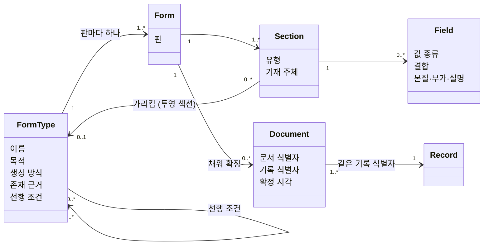

# Formology 명세

> **성격**: 규범(normative) · **판**: 0.1.0 · **성숙도**: 초안
>
> 이 문서가 Formology의 **규칙과 용어 정의의 정본**입니다. 다른 문서는 이 문서를 풀어 설명하는 해설이며, 해설과 이 문서가 다르면 이 문서가 맞습니다.

---

## 1. 범위

### 1.1 이 명세가 정하는 것

**서식에서 무엇이 어떻게 도출되는가.** 구체적으로는 셋입니다.

1. 서식을 이루는 개념과 그 사이의 관계 (3장)
2. 서식 선언과 작성된 문서에서 데이터 구조와 온톨로지를 내는 규칙 (4장)
3. 도출된 것 가운데 무엇이 계산이고 무엇이 제안인가 (5장)

### 1.2 정하지 않는 것

- **구현.** 저장소, 언어, 스키마 형식, 화면, 배포는 구현체의 몫입니다. Formology에는 구현체가 없습니다.
- **절차.** 워크숍을 어떻게 진행하는가는 [워크숍 가이드](workshop.md)의 해설이며 적합성 대상이 아닙니다.
- **적용 범위 밖의 것.** 확정되는 순간이 없는 것 — 원시 스트림 처리, 실시간 제어, 순수 알고리즘 ([방법론 「신호는 어디에 있는가」](methodology.md#신호는-어디에-있는가)).

### 1.3 누가 이 명세에 맞추는가

| 대상 | 뜻 |
|---|---|
| **서식 선언** | 한 조직의 서식들을 3장의 개념으로 적은 것. 종이 스케치든 파일이든 형식은 묻지 않습니다 |
| **도출기** | 서식 선언과 문서를 받아 데이터 구조와 온톨로지를 내는 것. 사람이 손으로 해도, 프로그램이 해도 같은 규칙을 따릅니다 |

### 1.4 규범 표현

이 문서에서 다음 세 표현은 정해진 뜻으로만 씁니다.

| 표현 | 뜻 |
|---|---|
| **~해야 한다 / ~하지 않는다** | 필수. 어기면 이 명세에 맞지 않습니다 |
| **~하는 것이 좋다** | 권고. 따르지 않을 이유가 있으면 따르지 않아도 됩니다 |
| **~할 수 있다** | 허용. 해도 되고 하지 않아도 됩니다 |

규범 표현은 판정에 필요한 곳에만 씁니다. 방법을 강제하기 위해 쓰지 않습니다.

### 1.5 현업에게 노출되는 것

이 명세의 어떤 용어도 현업에게 요구되지 않습니다. 현업에게 가는 것은 **서식 한 장을 앞에 놓고 묻는 업무의 말**입니다. 각 규칙에 판정 질문이 붙어 있는 까닭이 그것입니다.

---

## 2. 용어

정의는 3장에 있습니다. 여기서는 이름만 고정합니다.

| 용어 | 한국어 | 한 줄 |
|---|---|---|
| FormType | 서식 | 현업이 이름으로 부르는 업무 문서의 종류 |
| Form | 양식 | 한 서식의 한 판(version)의 구조 |
| Section | 섹션 | 양식 안의 의미 단위 묶음 |
| Field | 칸(필드) | 섹션 안의 입력 단위 |
| Document | 문서 | 한 양식을 채워 확정한 진술 |
| Record | 레코드 | 문서들에서 도출된 저장 형태 |
| Binding | 결합 | 칸의 값이 어느 시점에 묶이는가 |
| Precondition | 선행 조건 | 이 서식을 쓰기 전에 있어야 하는 것 |
| Mandate | 존재 근거 | 이 서식이 있어야 하는 이유 |
| Competency Question | 역량질문 | 도출된 구조가 답할 수 있어야 하는 질문 |
| Proposal | 제안 | 기계가 문서 내용을 읽어 내놓은, 아직 채택되지 않은 판단 |

`Document`와 `Record`는 기록관리 표준(ISO 15489 · ISO 23081)의 document · record와 축이 다릅니다. 대응은 [용어 사전](glossary.md#기록관리-표준과의-대응-iso-15489--iso-23081)에 있습니다.

---

## 3. 개념 체계

### 3.1 서식 (FormType)

현업이 이름으로 부르는 업무 문서의 종류입니다. 서식의 경계는 **현업이 다른 서식이라고 하면 다른 것**으로 정합니다.

서식은 다음 속성을 가집니다.

| 속성 | 값 | 판정 질문 |
|---|---|---|
| **이름** | 현업이 부르는 이름 그대로 | "이걸 뭐라고 부르세요?" |
| **생성 방식** | 1차 · 2차 | "이건 누가 채웁니까, 아니면 저절로 채워집니까?" |
| **목적** | 요청 · 지시 · 기록 · 보고 · 확인 · 약속 ([3.7](#37-목적)) | "이 서류로 무슨 일을 합니까?" |
| **존재 근거** | 법령 · 계약 · 내규 · 관행 ([3.8](#38-존재-근거)) | "이걸 안 쓰면 무슨 일이 생깁니까?" |
| **선행 조건** | 0개 이상 ([3.9](#39-선행-조건)) | "이거 쓰기 전에 반드시 있어야 하는 서류가 뭔가요?" |

### 3.2 양식 (Form)

**한 서식의 한 판의 구조**입니다. 섹션과 칸으로 이루어집니다.

- 서식이 개정되면 새 양식이 생깁니다. 서식 하나에 양식이 여럿일 수 있습니다.
- 같은 판을 PC 화면, 태블릿, 인쇄물로 다르게 보이는 것은 **표현**이며 양식이 아닙니다. 표현은 이 명세가 다루지 않습니다.

### 3.3 섹션 (Section)

양식 안의 의미 단위 묶음입니다. 유형은 넷이고 두 무리로 갈립니다.

| 무리 | 유형 | 하는 일 |
|---|---|---|
| **정의** | Main | 이 서식이 정의하는 주 엔티티의 칸 묶음. 한 양식에 여럿일 수 있습니다 |
| **정의** | Child | 한 문서 안에서 되풀이되는 행. 부모는 하나입니다 |
| **투영** | Reference | 이미 있는 다른 서식의 것을 **지금 값으로** 가리킵니다 |
| **투영** | Attachment | 이미 있는 다른 것을 **그때 값으로** 붙입니다. 파일을 붙이는 것도 여기에 듭니다 |

정의 섹션은 엔티티의 **출처**이고, 투영 섹션은 이미 있는 엔티티에서 **그 맥락에 필요한 것만 골라 옵니다.**

섹션은 **기재 주체**를 가질 수 있습니다 — 누가, 어느 시점에 이 묶음을 채우는가.

### 3.4 칸 (Field)

섹션 안의 입력 단위입니다. 칸은 세 가지를 가집니다.

**값 종류** — 칸에 무엇이 들어가는가.

| 값 종류 | 뜻 |
|---|---|
| 글 | 한 줄 또는 여러 줄의 문자 |
| 수 | 정수 또는 소수 |
| 날짜 · 시각 | 날짜, 시각, 또는 둘 다 |
| 예/아니오 | 체크 하나 |
| 선택 | 선택지 가운데 하나 |
| 다중 선택 | 선택지 가운데 여럿 |
| 측정값 | 수치이거나 정성 값(정상 · 없음)이거나 |
| 파일 | 붙인 파일 |
| 자동 | 사람이 적지 않고 주어지는 값 (채번, 작성자, 작성 시각) |

**결합** — 값이 어느 시점에 묶이는가. 값은 넷입니다.

| 결합 | 뜻 |
|---|---|
| **자기 값** | 이 문서가 스스로 말하는 값 |
| **참조** | 지금 참 — 읽는 시점에 원본 레코드가 갖는 값 |
| **붙임** | 그때 참 — 고정 시점의 값. 고정 시점은 작성 · 승인 · 주기 · 사건 가운데 하나 |
| **미결정** | 참조인지 붙임인지 업무가 아직 정하지 않음 |

정의 섹션의 칸은 기본이 자기 값, Reference 섹션의 칸은 기본이 참조, Attachment 섹션의 칸은 기본이 붙임입니다. 칸은 섹션의 기본을 뒤집을 수 있습니다.

**한 가지 예외.** 정의 섹션 안에 있더라도 **다른 서식의 것을 고르는 칸**(규칙 8)은 자기 값이 아닙니다. 그 칸은 남의 것을 가리키므로 참조인지 붙임인지를 물어야 하고, 답이 없으면 **미결정**입니다.

**요소 분류** — 본질적 · 부가적 · 설명적.

| 분류 | 판정 질문 | 귀결 |
|---|---|---|
| 본질적 | "이것 없이 여전히 이 서식입니까?" → 아니오 | 필수 |
| 부가적 | "있으면 더 좋습니까?" → 예 | 선택 |
| 설명적 | "이건 적어 넣는 것입니까?" → 아니오 | 저장하지 않음 |

### 3.5 문서 (Document)

한 양식을 채워 **확정한 진술**입니다. 문서는 다음을 가집니다.

- **문서 식별자** — 이 진술 하나를 가리킵니다.
- **기록 식별자** — 이 진술이 무엇에 관한 것인지를 가리킵니다. 같은 것을 정정한 문서들은 기록 식별자가 같습니다.
- **양식** — 어느 판으로 쓰였는가.
- **확정 시각.**

### 3.6 레코드 (Record)

문서들에서 도출된 저장 형태입니다. 레코드의 현재 값은 **같은 기록 식별자를 가진 문서 가운데 가장 나중에 확정된 것**이 정합니다.

레코드는 진술이 아니라 진술의 파생입니다. 증거는 문서에 있습니다.

### 3.7 목적

| 값 | 뜻 | 판정 질문 |
|---|---|---|
| 요청 | 상대가 무엇을 해 주기를 구한다 | "누구에게 해 달라는 것입니까?" |
| 지시 | 상대가 무엇을 하도록 정한다 | "받은 사람이 거절할 수 있습니까?" → 아니오 |
| 기록 | 일어난 사실을 적는다 | "누구에게 보내려고 쓰는 것입니까?" → 아니오 |
| 보고 | 한 일의 결과를 알린다 | "무엇을 끝내고 쓰는 것입니까?" |
| 확인 | 이미 있는 사실이 맞다고 증명한다 | "무엇이 맞다고 서명하는 것입니까?" |
| 약속 | 앞으로 지킬 것을 서로 정한다 | "어기면 책임을 지는 것입니까?" |

**확인은 승인이 아닙니다.** 승인은 사전 관문입니다 — 승인되기 전에는 문서가 효력을 갖지 않습니다. 확인은 이미 효력을 가진 기록에 사후로 붙는 증명입니다.

### 3.8 존재 근거

| 값 | 뜻 |
|---|---|
| 법령 | 법 · 규정이 작성을 요구한다 |
| 계약 | 거래 상대와의 약속이 요구한다 |
| 내규 | 조직이 스스로 정한 규칙이 요구한다 |
| 관행 | 아무도 정하지 않았는데 쓰고 있다 |

관행이 답인 서식은 걷어낼 후보입니다.

### 3.9 선행 조건

이 서식의 문서를 쓰기 전에 있어야 하는 것입니다. 항은 셋이고 "둘 다"로 묶을 수 있습니다.

| 항 | 예 |
|---|---|
| **문서** | 검사기록지가 있어야 한다 |
| **문서의 조건** | 검사기록지의 판정이 불합격이어야 한다 |
| **시간** | 승인요청서를 쓴 지 3일이 지나야 한다 |

선행 조건은 흐름도의 화살표를 뒤집어서는 얻어지지 않습니다. 따로 적습니다.

---

## 4. 규칙

규칙 번호는 판이 바뀌어도 다시 쓰지 않습니다. 폐기된 번호는 비워 둡니다. 각 규칙의 마지막 줄은 **어긴 것으로 보는 관찰**입니다.

### 4.1 구조

**규칙 1 — 서식 하나가 주 엔티티 하나를 정의한다.**
서식은 주 엔티티 하나를 정의해야 한다. Main 섹션이 여럿이면 모두 그 엔티티의 칸 묶음이다.
- 어긴 것: 서로 다른 서식이 유형 값 하나로 한 엔티티에 합쳐져 있다. 또는 Main 섹션마다 엔티티가 따로 생겼다.

**규칙 2 — 칸은 속성이 된다.**
정의 섹션의 칸은 그 섹션이 정의하는 엔티티의 속성이 되어야 한다.
- 어긴 것: 서식에 있는 칸이 도출 결과에 없다. 또는 서식에 없는 속성이 도출 결과에 있다(자동 값은 제외).

**규칙 3 — Child 섹션은 새 엔티티와 1:N이 된다.**
Child 섹션은 부모에 속하는 새 엔티티가 되어야 하고, 행 하나가 레코드 하나가 되어야 한다. 행의 순서는 보존해야 한다.
- 어긴 것: 되풀이되는 행이 한 칸에 뭉쳐 들어가 있다.

**규칙 4 — Reference 섹션은 이미 있는 엔티티로의 관계가 된다.**
Reference 섹션은 새 엔티티를 만들지 않는다. 가리키는 대상을 **무엇으로 찾는지**를 함께 적어야 한다. 찾지 못한 참조는 지어 채우지 않고 찾지 못했다고 보고해야 한다.
- 어긴 것: 참조할 대상이 정의 섹션처럼 다시 정의되어 있다. 또는 찾지 못한 참조가 빈 값이나 임의 값으로 조용히 채워졌다.

**규칙 5 — Attachment 섹션은 그때 값의 고정이 된다.**
붙임은 고정 시점 이후 원본이 바뀌어도 바뀌지 않아야 하고, **어디서 왔는지**를 가리켜야 한다. 구현 방식은 구현체가 정한다.
- 어긴 것: 원본을 고쳤더니 붙임 값이 따라 바뀌었다. 또는 붙임 값이 어느 원본에서 왔는지 알 수 없다.

**규칙 6 — 결합은 칸마다 정해진다.**
섹션이 기본 결합을 정하고, 칸이 필요할 때 이를 뒤집는다. 정의 섹션 안에서 다른 서식의 것을 고르는 칸은 기본이 미결정이다. 도출 결과에서 칸의 결합 넷([3.4](#34-칸-field))은 서로 구별되어야 한다.
- 판정 질문: "이 칸은 나중에 저쪽이 바뀌면 같이 바뀌어야 하나요, 그대로 남아야 하나요?"
- 어긴 것: 도출 결과만 보고는 어떤 값이 붙임인지 복사해 둔 것인지 알 수 없다.

**규칙 7 — 미결정을 기본값으로 메우지 않는다.**
결합이 미결정인 칸에 참조나 붙임을 임의로 정하지 않는다. 서식이 정하지 않은 것은 정하지 않은 채로 남겨야 한다.
- 어긴 것: 업무가 정한 적 없는 관계나 시간 결합이 도출 결과에 정해진 것처럼 들어 있다.

### 4.2 값

**규칙 8 — 선택의 사상은 선택지의 출처가 가른다.**
다른 서식이나 목록에서 고르면 그 엔티티로의 관계가 되고, 서식 자신이 선택지를 고정해 두었으면 값 집합이 된다.
- 판정 질문: "이건 어디서 고르는 겁니까?"
- 어긴 것: 다른 서식의 것을 고르는 칸이 글로 저장되어 원본과 이어지지 않는다.

**규칙 9 — 다중 선택은 고른 것 하나가 한 행이다.**
고른 선택지마다 행 하나가 되어야 한다. 고르지 않은 선택지는 행이 되지 않는다.
- 어긴 것: 고르지 않은 선택지가 "아니오" 행으로 저장되어 있다. 또는 고른 것들이 한 칸에 이어 붙어 있다.

**규칙 10 — 측정값은 선택형 값이다.**
수치와 정성 값이 섞이는 칸은 수치 자리와 글 자리를 따로 두고, 행마다 정확히 하나만 채워야 한다.
- 어긴 것: 수치가 글로 저장되어 비교 · 집계를 잃었다. 또는 정성 값이 들어갈 자리가 없어 행이 버려졌다.

**규칙 11 — 값이 없는 데에는 종류가 있다.**

| 종류 | 무슨 일이 있었나 | 도출 |
|---|---|---|
| 안 씀 | 칸이 보였고 비워 두었다 | 값 없음. 지어 채우지 않는다 |
| 고르지 않음 | 선택지가 있었고 아무것도 고르지 않았다 | 빈 목록 |
| 그 판에 없던 칸 | 문서를 쓸 때의 양식에 그 칸이 없었다 | 칸 자체가 없음. 빈 값으로 채우지 않는다 |
| 조건부로 안 보임 | 조건이 거짓이라 칸이 나타나지 않았다 | 입력이 가르는 만큼만 가른다 |

입력이 "조건부로 안 보임"과 "안 씀"을 같은 모양으로 넘기면 저장도 둘을 가를 수 없다. 그때는 둘이 섞였다고 밝혀야 하고, 가를 수 있는 것처럼 꾸미지 않는다.
- 어긴 것: 없던 칸이 빈 값으로 채워져 "비워 둠"과 구별되지 않는다. 또는 비운 칸에 기본값이 들어가 있다.

**규칙 12 — 계산되는 칸은 진술이 아니다.**
다른 칸에서 계산되는 칸은 그렇게 표시해야 하고, 사람이 적은 값과 구별되어야 한다.
- 어긴 것: 계산된 값과 적어 넣은 값이 도출 결과에서 구별되지 않는다.

**규칙 13 — 현업의 이름을 보존한다.**
서식과 칸의 현업 이름은 도출 결과에 함께 남아야 한다. 구현이 쓰는 식별자가 그것을 대체하지 않는다.
- 어긴 것: 도출 결과에서 현업이 부르는 이름을 찾을 수 없다.

### 4.3 기록

**규칙 14 — 문서는 고쳐 쓰지 않는다.**
확정된 문서는 바뀌지 않는다. 정정은 같은 기록 식별자를 가진 새 문서이고, 없애는 것도 문서다.
- 어긴 것: 확정된 문서의 내용이 바뀌었는데 이전 내용이 남아 있지 않다.

**규칙 15 — 레코드는 문서에서 다시 만들 수 있다.**
레코드와 그 위의 모든 도출 결과는 쌓인 문서로부터 통째로 다시 만들 수 있어야 한다. 쓰기 지점은 문서 하나다.
- 어긴 것: 문서에는 없고 레코드에만 있는 사실이 있다.

**규칙 16 — 선언에 맞지 않는 문서는 버리지도 지어 채우지도 않는다.**
양식에 맞지 않는 문서나 칸을 만나면 그 부분을 건너뛰고, 무엇을 왜 건너뛰었는지를 세어 보고해야 한다.
- 어긴 것: 맞지 않는 문서가 조용히 사라졌다. 또는 맞지 않는 값이 맞는 것처럼 바뀌어 들어갔다.

**규칙 17 — 문서는 자기가 쓰인 판을 안다.**
문서는 쓰일 때의 양식으로 읽어야 한다. 과거 문서를 새 양식으로 옮겨 쓰지 않는다. 판이 다른 문서를 함께 집계할 때는 칸 사이의 대응을 명시해야 한다.
- 어긴 것: 과거 문서를 열었더니 쓸 때 없던 칸이 빈칸으로 보인다.

### 4.4 흐름

**규칙 18 — 전이는 문서다.**
업무의 진행은 문서가 쌓여서 일어난다. 무효화와 취소도 문서다. 상태를 저장해 둘 수 있으나, 그 상태는 그 건에 쌓인 문서로부터 다시 계산할 수 있어야 한다.
- 어긴 것: 상태가 바뀌었는데 누가 언제 왜 바꿨는지를 말하는 문서가 없다.

**규칙 19 — 선행 조건은 선언한다.**
서식의 선행 조건([3.9](#39-선행-조건))을 적어 두면, 한 건에서 지금 쓸 수 있는 서식이 계산된다. 적지 않은 선행 조건을 추측해 채우지 않는다.
- 어긴 것: 선행 조건이 선언되지 않았는데 흐름이 정해진 것처럼 도출되어 있다.

**규칙 20 — 기재 주체는 칸에 남는다.**
섹션에 기재 주체가 적혀 있으면, 그 묶음의 값을 누가 언제 적었는지가 도출 결과에 남아야 한다.
- 어긴 것: 승인란이 채워졌는데 누가 채웠는지 알 수 없다.

### 4.5 서식의 속성

**규칙 21 — 2차 서식은 양식이 아니라 질문이다.**
생성 방식이 2차인 서식은 엔티티가 되지 않는다. 축적된 1차 문서에 대한 질의이며, 그 한 줄이 역량질문 하나다. 역량질문은 보존해야 하고, 도출이 끝난 뒤 하나씩 답해 보아야 한다.
- 어긴 것: 집계표가 사람이 채우는 테이블로 도출되어 있다. 또는 워크숍에서 나온 2차 서식 목록이 남아 있지 않다.

**규칙 22 — 서식의 종류는 이름에서 읽지 않는다.**
생성 방식, 목적, 존재 근거는 판정 질문으로 정한다. 이름의 접미어나 낱말에서 추론하지 않는다.
- 어긴 것: "~록"으로 끝난다는 이유로 2차로 분류되어 있다.

### 4.6 제안

**규칙 23 — 도출된 주장은 출처를 가리킨다.**
도출 결과의 모든 주장은 그것을 낳은 문서와 칸을 가리킬 수 있어야 한다. 출처 없는 주장은 만들지 않는다.
- 어긴 것: 어느 문서에서 나왔는지 댈 수 없는 관계나 개체가 있다.

**규칙 24 — 선언이 제안을 이긴다.**
사람이 선언한 것과 기계가 제안한 것이 다르면 선언을 따라야 한다.
- 어긴 것: 선언된 구조가 제안에 의해 바뀌었다.

**규칙 25 — 제안은 채택되기 전에는 효력이 없다.**
제안([5.2](#52-제안))은 사람이 채택해야 도출 결과가 된다. 채택은 업무의 말로 묻는다. 기각한 제안은 사유와 함께 남기고, 무엇이 그대로 채택되었는지를 기록해야 한다.
- 어긴 것: 기계의 판단이 사람을 거치지 않고 서로 다른 것을 하나로 합쳤다.

**규칙 26 — "같은 것인가"의 답은 셋이다.**
서로 다른 문서가 같은 개체를 가리키는지에 대한 판단은 **같다 · 모른다 · 다르다** 가운데 하나로 답해야 한다. "모른다"는 사람에게 간다.
- 어긴 것: 확신 없는 판정이 "같다" 또는 "다르다"로 처리되어 있다.

**규칙 27 — 옮기지 못한 것을 센다.**
서식에는 있으나 도출 결과에 자리가 없는 것은 무엇이 몇 건인지 보고해야 한다.
- 어긴 것: 서식의 어떤 구성이 도출에서 사라졌는데 아무 보고도 없다.

---

## 5. 도출의 세 등급

도출되는 것은 한 가지가 아닙니다. 무엇에 기대어 나오는가에 따라 셋으로 갈립니다.

| 등급 | 무엇에 기대는가 | 성질 |
|---|---|---|
| **계산** | 서식 선언과 규칙 | 같은 입력이면 같은 결과 |
| **제안** | 문서 내용을 읽은 기계의 판단 | 확률적. 사람이 채택해야 효력 |
| **도출 밖** | 서식에 없는 것 | 필요하면 밖에서 채움 |

### 5.1 계산

서식 선언에서 규칙만으로 정해지는 것입니다.

- 엔티티와 속성 (규칙 1 ~ 3)
- 선언된 관계와 그 시간 결합 (규칙 4 ~ 6)
- 한 건에서 지금 쓸 수 있는 서식 (규칙 19)
- 채워지지 않은 선행 조건, 후속이 생기지 않는 건, 정해진 순서를 건너뛴 경로

*"온톨로지는 충분히 정합한 서식이 쌓였을 때 계산된다"*는 말은 이 등급에 대한 것입니다.

### 5.2 제안

서식이 선언하지 않았으나 문서 내용에서 읽어낼 수 있는 것입니다.

- 선언되지 않은 관계
- 서로 다른 문서가 같은 개체를 가리키는가 (규칙 26)
- 서로 다른 서식의 낱말이 같은 개념인가
- 여러 서식에 되풀이되는 섹션이 같은 것인가 (공유 타입 후보)
- 상위 개념

제안은 같은 입력에서도 달라질 수 있습니다. 그래서 규칙 23 ~ 26이 붙습니다 — 출처를 가리키고, 선언에 지고, 사람이 채택합니다.

### 5.3 도출 밖

- 분류학적 상위 체계 — 개 ⊂ 포유류 ⊂ 동물
- 전칭 · 부정 공리 — "모든 X는 Y가 아니다"
- 업무가 다루지 않는 개념 사이의 관계

서식에 없는 까닭은 업무가 그것을 다루지 않기 때문입니다. 표준 준수나 전문가 추론이 요구될 때 밖에서 채웁니다.

---

## 6. 적합성

### 6.1 프로파일

한꺼번에 다 맞출 필요가 없습니다. 프로파일은 넷이고, 기본 프로파일은 나머지의 전제입니다.

| 프로파일 | 규칙 | 얻는 것 |
|---|---|---|
| **기본** | 1 ~ 3, 7 ~ 16, 21 ~ 23, 27 | 엔티티와 속성. 정직한 결측. 다시 만들 수 있는 저장 |
| **시간** | 4 ~ 6, 17 | 관계와 시간 결합. 과거 문서의 보존 |
| **흐름** | 18 ~ 20 | 지금 쓸 수 있는 서식. 진행의 추적 |
| **어휘** | 24 ~ 26 | 개념 통합과 공유 타입. 같은 개체 판정 |

[자동 도출 원리의 해상도 표](automation.md#해상도-등급)와의 대응: 기본 = 주체 지목 · 시간 = 참조 대상 특정과 칸별 결합 · 흐름 = 상태 표시, 선행 명시, 완결성 · 어휘 = 어휘 일관, 공유 타입.

### 6.2 적합성 주장

적합성을 말할 때는 **명세의 판과 프로파일**을 함께 적어야 합니다.

> 예: "Formology 0.1 기본 · 시간 프로파일"

프로파일의 일부 규칙만 맞추는 경우에는 맞추지 못한 규칙 번호를 적습니다. 규칙 27(옮기지 못한 것을 센다)을 따르는 도출기는 이 목록을 스스로 낼 수 있습니다.

### 6.3 쓸모의 판정

규칙을 다 지켜도 도출이 쓸모 있다는 뜻은 아닙니다. 쓸모는 **역량질문 응답률**로 잽니다 — 보존한 역량질문 가운데 도출된 구조로 답할 수 있는 것의 비율입니다. 답하지 못하는 질문 하나가 빠진 엔티티나 관계 하나입니다.

---

## 7. 주장 대장

방법론의 주장이 지금 어느 만큼 확인되었는가입니다. 상태는 넷입니다 — **실측됨**(공개된 자료로 재현 조건과 함께) · **부분** · **미검증** · **철회**(한때 주장했으나 거두었다). 지금 실측됨과 철회에 해당하는 행은 없습니다.

| 주장 | 상태 | 근거와 한계 |
|---|---|---|
| 워크숍으로 서식 목록에 그 자리에서 합의할 수 있다 | 부분 | 사례 1건 — 2시간 15분, 22개 서식, 참석자 7명 전원 동의 ([사례 연구](casestudy.md)). 대조군 없음 |
| 서식 구조에서 엔티티 · 속성 · 반복 행이 도출된다 (규칙 1 ~ 3) | 부분 | 위 사례 1건. 여러 도메인에 걸친 측정 없음 |
| 서식은 참조와 붙임을 이미 구별하고 있다 (규칙 4 ~ 6) | 미검증 | 사례의 관찰뿐. 서식 집합에서 칸별 결합을 판정해 본 측정이 없다. 우리가 읽은 서식 표준(FHIR Questionnaire, XForms)에서 이 구별을 선언하는 자리는 찾지 못했다 — 표준이 두지 않은 데에는 이유가 있을 수 있다 |
| 동형 섹션을 기계가 찾아낼 수 있다 | 부분 | EU eForms SDK 1.15.1의 51개 서식에서 같은 섹션의 정답률 약 86% (n=52). 구성이 비슷하고 뜻이 다른 경우는 표본 부족이고, 같은 사례의 재실행에서 판정이 뒤집혔다 ([자동 도출 원리 4장](automation.md#4-동형성-판정)) |
| 선행 조건에서 결손 · 병목 · 규범과 실태의 괴리가 계산된다 | 부분 | EU TED 실 공고 50건에서 선행 조건 충족 76% · 미충족 20% · 모델 밖 4%. 미충족의 상당수는 선행 조건 모델이 대체 경로를 놓친 것 ([자동 도출 원리 6장](automation.md#6-창발적-가이던스)) |
| 선행 조건에서 가능 행위 목록 · 죽은 프로세스가 계산된다 | 미검증 | 계산해 본 기록 없음 |
| 도출된 구조가 업무가 쓰는 온톨로지 부분집합에 닿는다 | 미검증 | 실 서식 집합에서 역량질문 응답률([6.3](#63-쓸모의-판정))을 잰 기록 없음 |
| 제안 등급의 판단이 안정적이다 | 미검증 | 동형성 판정에서 뒤집힘이 관측됨. 이 명세는 안정적이라고 가정하지 않는다 (규칙 25) |

### 7.1 틀렸다고 인정하는 조건과 재는 법

[철학과 원칙 9장](philosophy.md#9-formology가-틀렸다고-인정하는-조건)의 세 조건을 어떻게 재는가입니다.

| 조건 | 재는 법 | 지금 |
|---|---|---|
| 같은 도메인에서 엔티티 경계를 거듭 다시 그어야 한다 | 서식이 늘거나 개정될 때 **칸 · 서식의 추가**로 끝난 변경과 **엔티티 경계의 변경**을 요구한 변경의 비율 | 측정 없음 |
| 현업이 자기 서식을 보고도 검증하지 못한다 | 워크숍 산출물을 현업이 확인하는 데 걸린 시간과 수정 요구의 수 | 사례 1건 |
| 서식 없이 설계한 시스템이 일관되게 낫다 | 같은 조직에서 두 방식을 나란히 돌린 대조 | 대조군 없이는 잴 수 없다 |

---

## 8. 판

- 판 번호는 `주.부.수` 세 자리입니다. 규칙의 뜻이 바뀌거나 규칙이 폐기되면 가운데 자리를, 문구만 다듬으면 끝자리를 올립니다.
- **0.x 판에서는 무엇이든 바뀔 수 있습니다.** 이 명세에 맞춘다고 말할 때 판을 적어야 하는 까닭입니다.
- 규칙을 폐기할 때는 한 판 동안 "폐기 예정"으로 표시한 뒤 지웁니다. 번호는 다시 쓰지 않습니다.
- 바뀐 것은 [CHANGELOG](../CHANGELOG.md)에 규칙 번호로 적습니다.
- 명세는 머리에 성숙도를 적습니다 — **초안**(바뀔 것으로 본다) · **시범**(써 보는 중) · **안정**(바꾸려면 근거가 필요하다). 해설 문서는 성숙도를 따로 매기지 않습니다.

---

**Formology** — *Workflow First, Ontology Follows*
